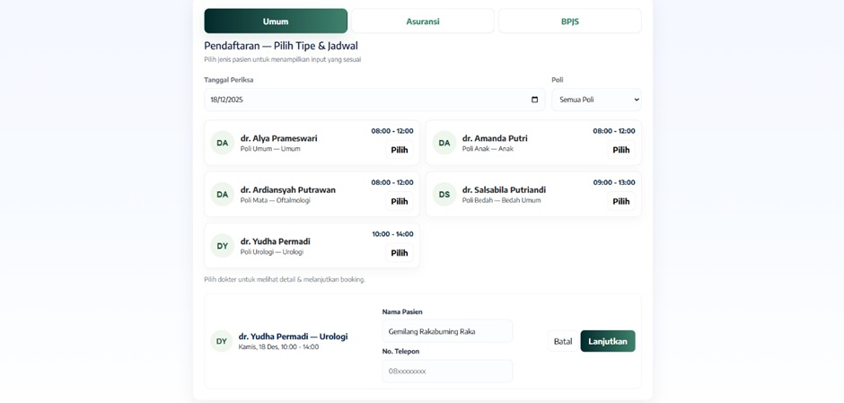
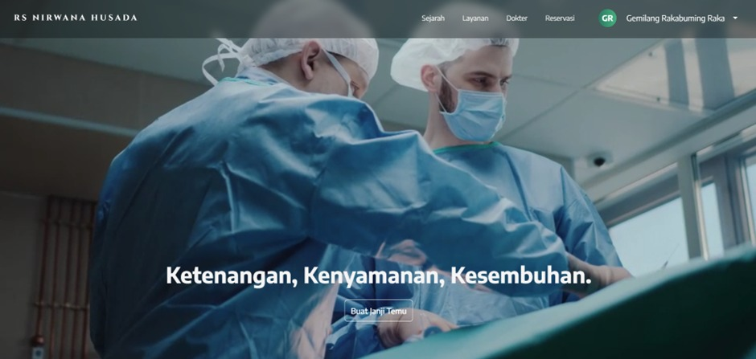
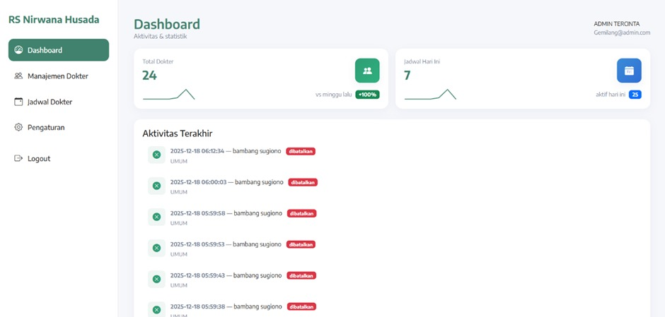
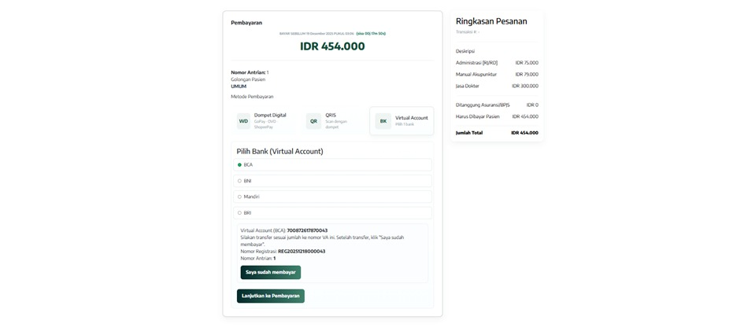
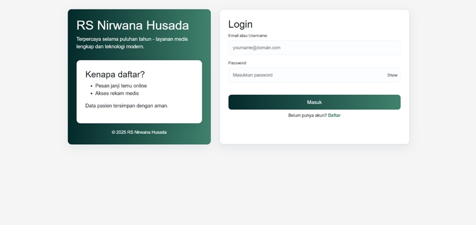

# Hospital Service Web Application — RumahSakit.com

> **Academic project.** Built as the final exam (UAS) project for the
> Object-Oriented Programming course. "Nirwana Husada" is a fictional
> hospital used for coursework purposes only; all data in this repository
> is dummy data.
>
> **Group project — 4 members.** I was responsible for the **front end**:
> patient registration, doctor schedule booking, profile management,
> payment pages, and the admin dashboard views. The back end and database
> were developed by my teammates.
>
> Original team repository: https://github.com/gemilungs/Rumah-Sakit-Nirwana-Husada

## Overview

RumahSakit.com is a hospital information system website covering patient
registration, doctor appointment booking, patient profile management, and
online payment, together with an admin dashboard for managing hospital data.

## Features

**Patient**
- Registration and login, with ID card verification
- Doctor schedule browsing and appointment booking
- Booking history and cancellation
- Online payment via Midtrans
- Printable payment receipt

**Admin**
- Dashboard for managing patient, doctor, and booking data
- Payment confirmation for patient transactions
- Change username and password

## Tech Stack

PHP · MySQL · HTML · CSS · JavaScript · Bootstrap · Midtrans payment gateway

## Screenshots

## Running Locally

1. Start Apache and MySQL through XAMPP or Laragon.
2. Clone or download this repository into your web server directory
   (`htdocs` for XAMPP, `www` for Laragon).
3. Copy `config.example.php` to `config.php` and fill in your own database
   credentials. `config.php` is intentionally not tracked by Git.
4. Import the database schema, then run the scripts in `migrations/`.
5. Open `http://localhost/hospital-service-web` in your browser.

Midtrans credentials are not included in this repository. To use the
payment feature, supply your own Midtrans server key.

## Directory Structure

- Root `.php` files — page controllers and views
- `api/` — back-end endpoints
- `includes/`, `lib/` — shared components and helper functions
- `css/`, `js/`, `Media/` — front-end assets
- `migrations/` — database migration scripts
- `dev/`, `tools/` — development utilities
